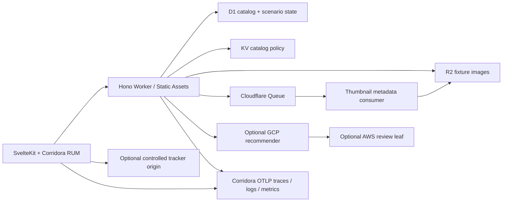

# Orbit & Fern — Cloudflare gallery

Published 2026-10-11 · Updated 2026-10-11

A standalone SvelteKit 3 gallery and TypeScript/Hono Worker that demonstrates
browser-to-server traces, Cloudflare bindings, cross-cloud recommendations,
queued image metadata, and a daily recoverable catalog regression.



Requires Node.js 22.12+ (24 recommended), npm, Python 3.10+, and Chromium for
browser validation. Cloud deployment additionally requires a Cloudflare account
with Workers Paid and R2 enabled, a scoped deployment API token, and the GitHub
CLI when scheduled workflows are enabled. Dependencies are pinned in
`package-lock.json`. The repository has no sibling-file runtime dependencies.

## Start locally

```sh
npm ci
./setup configure
./setup deploy
./setup run
```

Choose local mode. Empty Corridora keys/endpoint disable export while the full
seeded application and workerd D1/R2/KV/Queue implementations still run. Open
<http://localhost:4101>, choose Orbit lamp, and prepare image metadata. The
consumer reads R2 and writes thumbnail metadata back to R2 and D1; it does not
claim to resize image pixels. `./setup` without arguments walks through the same
configuration, seed, start and browser verification workflow.

To connect your own tenant or the maintained Demo, follow the complete
[Corridora setup guide](docs/corridora-setup.md). Never use shared Demo credentials
in public CI, forks or source control.

```sh
npx playwright install chromium
./setup verify
./setup scenario --phase regression --duration 120
./setup scenario --phase recover --duration 120
```

The seeded Orbit lamp slows by 1.5 seconds and performs three R2 metadata reads.
Fern planter remains healthy. Scenario overrides expire in at most 600 seconds;
daily UTC derivation remains effective even if Cron is missed. Recovery overrides
suppress the daily fault only until their expiry. Daily/default fault window is
13:00–13:10 UTC. `/api/demo/status` reports the actual build identity separately
from the simulated release.

## Deployment and teardown

```sh
./setup configure                  # select cloud; choose a unique prefix
./setup deploy --plan              # no network calls, credentials or changes
./setup deploy                     # reviewed plan, then real provisioning
./setup run                        # cloud: health check and deployed URL
./setup verify                     # browser incident + recovery + heartbeat
./setup destroy --plan
./setup destroy                    # deletes only inventory-owned resources
```

Configuration is stored in ignored owner-only `.sample/config.json` and
`.sample/secrets.json`; resources are inventoried after every successful create.
Rerunning deploy resumes. An explicit existing D1/R2/KV/Queue can be selected;
these resources must be dedicated to this sample's schema/fixture keys and are
never deleted. The script refuses to take over an existing Worker without its
ownership inventory or a queue with consumers. Native destinations have unique
names and are also inventoried. Keep the inventory safe. Only the known seeded
R2 objects are removed before an owned bucket is deleted; other objects cause the
provider to reject deletion rather than being wiped.

`./setup deploy --dry-run` is the same plan operation. `npx wrangler deploy
--dry-run --config .sample/wrangler.json` additionally bundles and validates an
already generated configuration locally. The script uses provider secret
bindings and never passes secret values in command-line arguments. A normal
login/password is never requested. Custom hostnames require the zone ID; otherwise
the account's workers.dev subdomain is discovered.

The baseline allocates **$5/month for the Cloudflare account**, plus metered
usage above included allowances. Keep gallery dynamic traffic under 100,000 small
requests/month, images under a few MB, and egress under 0.5 GB/month. Workers CPU
is capped at 50 ms; retry count is two; all known data/queues are bounded. Requests
from the public internet can exceed planning estimates. Provider budgets and
fleet-level usage monitoring remain operator responsibilities. See
[Workers pricing](https://developers.cloudflare.com/workers/platform/pricing/) and
[R2 pricing](https://developers.cloudflare.com/r2/pricing/).

## Daily browser and provider signals

Enable `ENABLE_SYNTHETICS=true` in setup and provide the published
`GITHUB_REPOSITORY`. Setup checks the existing GitHub CLI login and writes the
repository variables/secrets used by the checked-in workflows, without pushing
or creating a repository. The repository must already contain these workflow
files on `main`. `.github/workflows/daily.yml` executes the real Playwright
journey and retries missing same-day heartbeats. Cron also exercises backend
R2 reads, but does not substitute for a browser. For a reliable existing runner,
run `python3 scripts/watchdog.py` from its UTC scheduler with `SAMPLE_BASE_URL` and
`DEMO_CONTROL_TOKEN` in its protected environment. GitHub schedules can be delayed,
dropped or disabled after inactivity; a hosted daily incident is confirmed by a
completed heartbeat, not by the presence of a schedule.

Enable provider forwarding to create native Cloudflare logs/traces OTLP
destinations and configure the separate GraphQL metrics workflow. Supply a
read-only `CLOUDFLARE_ANALYTICS_TOKEN`; it never enters the Worker. Metrics are
15-minute closed-bucket DELTA samples. Delayed workflow runs can leave gaps;
Analytics data is sampled and is not a billing report. Native binding/backend
coverage is described in [the guide](docs/corridora-setup.md).

## Optional integrations

- Set `RECOMMENDER_URL` to the controlled GCP sample's HTTPS origin. The Worker
  calls `/api/recommendations?product_id=demo-product`, injects W3C trace context,
  and optionally adds only `DOWNSTREAM_AUTH_TOKEN`. Empty config uses a stable
  fixture. Outbound response bodies cap at 64 KiB and two seconds, with fallback.
- `npm run tracker` starts a separate controlled tracker on port 4108. Set
  `TRACKER_SIMULATOR_URL=http://localhost:4108/tracker.js?mode=regression` locally,
  rerun configure/deploy and run. The UI requires consent before loading it. The
  script delays for one second, adds a bounded 250-ms long task, shifts an ad
  slot, and requests a failed pixel. Set `TRACKER_ALLOWED_ORIGIN` for timing
  access. `worker/tracker.ts` is also deployable as a standalone Worker using
  the provided [tracker deployment guide](docs/tracker.md).
- Real Meta/Google advertising is disabled and no real vendor tags are shipped.
  Adding an isolated test tag requires an explicit consent flow and an updated
  CSP. Never propagate keys, synthetic records or trace context to real vendors.

## Validate

```sh
npm run types
npm run check
npm run build
npm test
npm run test:setup
npm run test:browser
```

The browser test starts isolated local bindings and an OTLP capture server on
4411 using mock keys. It exercises the actual frontend and queue consumer,
regression, healthy control, recovery, and captures backend SDK traces, logs and
metrics. To assert actual browser CLIENT → Worker SERVER parentage offline,
provide a separately downloaded **real Corridora RUM distribution**:

```sh
RUM_BUNDLE_PATH=/absolute/path/corridora-rum.js npm run test:browser
```

No imitation SDK/header generator is used. Without that fixture, the test reports
that browser correlation was not asserted. Public CI validates the browser
journey and backend capture; stored Corridora correlation and native export
require operator verification. `PLAYWRIGHT_CHROMIUM_EXECUTABLE_PATH` optionally
selects an existing browser. Tests keep configuration in `.sample/test`; they do
not overwrite contributor setup answers.
